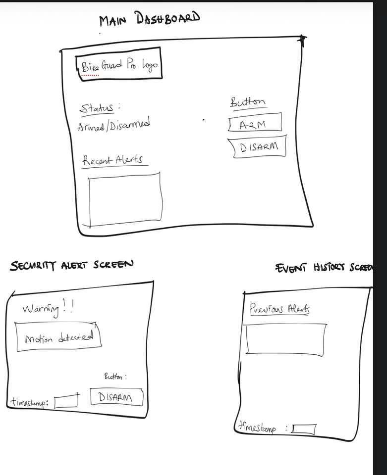

# BikeGuard Pro: Design

## Problem Statement

University students frequently rely on bicycles and electric bikes to commute to campus and travel between distant buildings to attend class. Because these items are repeatedly parked in high-traffic, outdoor areas on campus, they face continuous exposure to theft and vandalism.

Although traditional bicycle locks provide a physical layer of security, they provide zero real-time alerts when the bicycle is being tampered with. Henceforth, students are unaware if there was any potential tampering attempts on their vehicle. The lack of real-time information can result in the student suffering unexpected financial loss, disruption in daily transportation and anxiety when leaving personal transit items unattended. Furthermore, students do not have the ability to monitor their personal vehicles all the time because of lectures, laboratory sessions, etc. This in turn results in the need for a method to monitor their bikes while they are away.

## Solution

BikeGuard Pro is a smart bicycle security monitoring system that combines hardware sensors, embedded hardware, and a web-based application to help students monitor their parked bicycles. The system also maintains local motion detection and alarm functionality when the network connection is unavailable.

BikeGuard Pro aims to address the security concerns of university students who rely on bicycles as their daily commute vehicle. Our goal is to develop a security monitoring system that allows students to monitor their bicycles remotely and receive notifications of potential theft attempts.

### System Components

The system consists of three main components:

#### 1. Hardware Monitoring Device

- An ESP32 microcontroller connected to an accelerometer/gyroscope continuously monitors bicycle movement.

#### 2. Backend Server

- Communicates with the data from the monitoring device.
- A motion-detection algorithm analyzes sensor readings to distinguish between minor vibrations and potentially suspicious activity.

#### 3. Web Dashboard

- Displays the bike's monitoring status and the connection status to the vehicle.
- Allows the user to enable the monitoring system and configure how notifications are received.
- If the device is offline, the dashboard displays a connection error message. The device continues monitoring locally.
- When suspicious movement is detected, a security alert appears on the dashboard that the owner can view.
- Users can view the security history on the dashboard. Events can be sorted by newest date and time.

### Alert Flow

When suspicious movement is detected, the system:

1. Activates a buzzer to provide an immediate audible alarm.
2. Sends an alert to the backend server through a REST API over Wi-Fi.
3. Records the incident for future reference so that the user can view it in the security history.
4. Updates the web dashboard so the bicycle owner can view the alert.

If Wi-Fi is unavailable, the device still activates the buzzer. The dashboard and backend cannot receive the monitoring device's data until the connection is restored.

## UI Mockups

### Main Dashboard

The main dashboard allows users to monitor their bicycle's security status, arm and disarm the system, and view recent security alerts.

### Security Alert Screen

This screen notifies users when suspicious movement is detected, displays the time of the incident, and provides an option to disarm the alarm.

### Event History Screen

The event history screen displays previously recorded security alerts and their timestamps, allowing users to review past bicycle activity.
