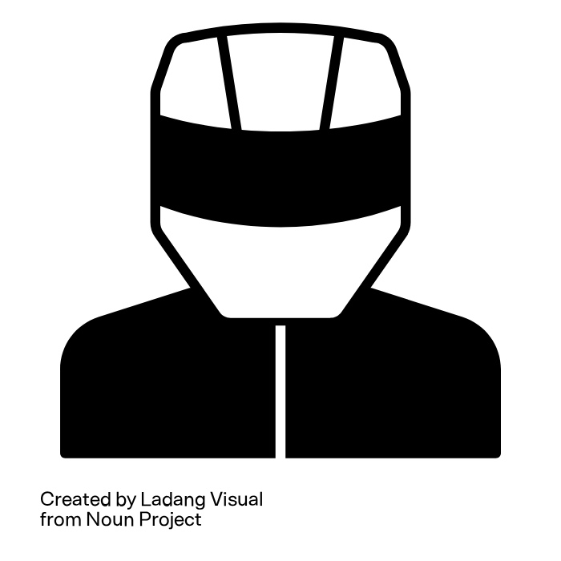

# BikeGuard Pro

## Mission

To enhance bicycle security and provide students with greater peace of mind through accessible technology.

## Team

| Role            | Name                  |
| --------------- | --------------------- |
| Project Manager | Prince Alehnwi Suh Jr |
| Designer        | Kevin Kim             |
| Designer        | Isaac Dario          |
| Developer       | Andy Fan              |
| Developer       | Kevin Huang           |

## Problem Statement

University students frequently rely on bicycles and electric bikes to commute to campus and travel between distant buildings to attend classes. Because these items are repeatedly parked in high-traffic, outdoor areas on campus, they face continuous exposure to theft and vandalism. According to UBC Vancouver's [2024 Campus Security Report](https://bog3.sites.olt.ubc.ca/files/2025/05/14ii_2025.06_Campus-Security-Annual-Report-UBCV.pdf), 96 bicycle theft incidents were reported to Campus Security in 2024, compared with 86 in 2023.

Although conventional bicycle locks provide a physical layer of security, they generally do not provide real-time alerts when a bicycle is being tampered with. Students attending lectures, laboratory sessions, or other campus activities are often unable to monitor their bicycles throughout the day. Consequently, the lack of real-time information can contribute to financial loss, transportation disruptions, and anxiety about leaving personal transportation devices unattended.
